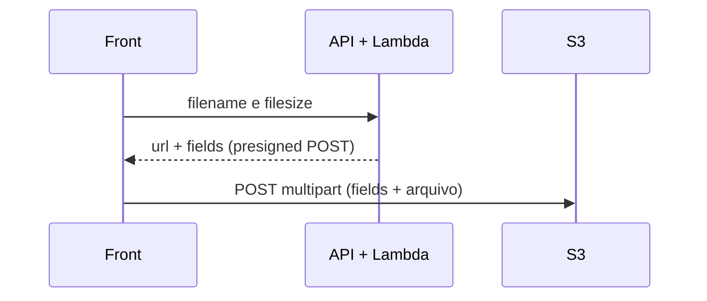

# S3 Presigned POST


Upload de arquivos direto do navegador para o Amazon S3 usando **presigned POST**. O front pede uma URL assinada a uma Lambda e envia o arquivo diretamente ao bucket.

---

## Stack

| Camada        | Tecnologia           | Uso                                       |
| ------------- | -------------------- | ----------------------------------------- |
| Front         | React 19             | Interface                                 |
| Front         | Vite                 | Dev server e build                        |
| Front         | Tailwind CSS         | Estilização                               |
| Front         | react-dropzone       | Seleção de arquivos por arrastar e soltar |
| Front         | axios                | Requisições HTTP e progresso do upload    |
| Backend       | AWS Lambda (Node.js) | Geração do presigned POST                 |
| Backend       | API Gateway (HTTP)   | Exposição das funções, com CORS           |
| Backend       | Serverless Framework | Deploy da infraestrutura                  |
| Backend       | zod                  | Validação do corpo da requisição          |
| Armazenamento | Amazon S3            | Bucket que recebe os arquivos             |
| Ferramentas   | TypeScript           | Tipagem em todo o projeto                 |
| Ferramentas   | pnpm                 | Gerenciador de pacotes (monorepo)         |
| Ferramentas   | Biome                | Lint e formatação                         |

---

## Como funciona



---

## Regras do upload

| Regra           | Valor                  |
| --------------- | ---------------------- |
| Extensão        | Obrigatória            |
| Tamanho máximo  | Menos de 1 MB          |
| Validade da URL | 10 minutos             |
| Tag do objeto   | `apply-lifecycle=true` |

---

## Como rodar

### Requisitos

- Node.js 24+
- pnpm 11.5+
- Credenciais AWS configuradas

### 1. Instalar as dependências

```bash
pnpm install
```

### 2. Backend

```bash
cd lambdas
serverless deploy
```

Copie a URL da API exibida no final do deploy.

### 3. Frontend

Crie `front/.env` com a URL copiada:

```env
VITE_API_URL=https://<api-id>.execute-api.<region>.amazonaws.com
```

Depois, inicie o servidor:

```bash
cd front
pnpm dev
```
